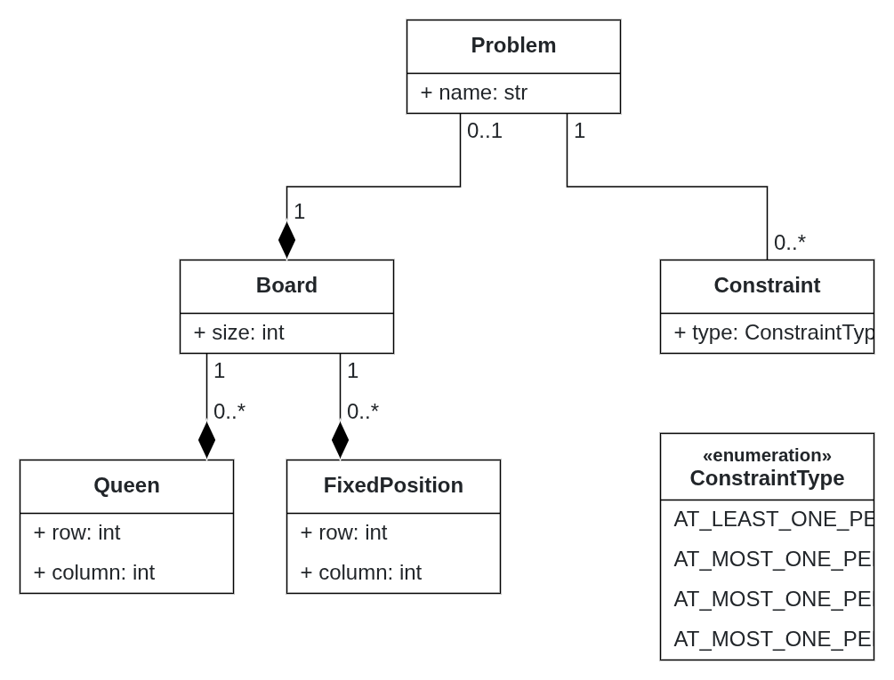

# Part I — N-Queens

## Problem DSL

### N-Queens completion

The selected problem is **N-Queens completion**. Given an \(N \times N\) chessboard with some queens already positioned, the goal is to place the remaining queens so that no two queens attack each other.

The constraints are:

- At most one queen per row.
- At most one queen per column.
- At most one queen per diagonal.

The problem model describes the board, the constraints, and any pre-filled queen positions. It does not itself describe the completed solution.

### Problem DSL metamodel

The Problem DSL metamodel is defined in BESSER. It contains the concepts `Problem`, `Board`, `Queen`, `FixedPosition`, and `Constraint`, as well as the `ConstraintType` enumeration.

The metamodel defines a `Problem` with a `Board` and a set of `Constraint` objects. The board can contain `Queen` objects and `FixedPosition` objects. The constraint types currently model the row, column, and diagonal rules.

### Example problem model

The following BESSER Object Diagram illustrates a small N-Queens problem instance. The board size is 4, and the problem is associated with the four constraint types.

The example is a **problem model**, not a solution model: it specifies the instance and its constraints. Pre-filled positions are represented using the `FixedPosition` concept when included in a particular instance.

## Codification

### Limit of 12 qubits

The quantum circuit implementation is subject to a limit of **12 qubits**. The encoding therefore affects the size of the instances that can be considered.

For a \(4 \times 4\) board:

- 4 rows correspond to 4 variables.
- Each variable requires \(\log_2(4)=2\) qubits to encode the column of the queen in that row.
- Total: \(4 \times 2 = 8\) qubits.

Therefore, a \(4 \times 4\) N-Queens instance fits within the 12-qubit limit. Under this encoding, a row variable represents the column selected for the queen in that row. Pre-filled positions restrict the corresponding variable to the specified column.

## Test instance

### Queens

The following board is used as a small example for the N-Queens completion problem:

| . | Q | . | . |
|---|---|---|---|
| . | . | . | `Q` |
| Q | . | . | . |
| . | . | `Q` | . |

## Solution DSL

### N-Queens
The solution always contains one queen per row. Therefore, we can represent $q_r$ as the column of the queen at row `r`. The constraints can then be written as follows (cannot be on the same column nor on the same diagonal):

$$\forall r \neq s, q_r \neq q_s \land |q_r - q_s| \neq |r-s| $$

CNF is really verbose. Here's the CNF for N=4:

$$
% One \; queen \; per \; row:
\newline
(11 \lor 12 \lor 13 \lor 14) \land (21 \lor 22 \lor 23 \lor 24) \land (31 \lor 32 \lor 33 \lor 34) \land (41 \lor 42 \lor 43 \lor 44)
\newline
\newline
\land [(\neg 11 \lor \neg 12) \land (\neg 11 \lor \neg 13) \land (\neg 11 \lor \neg 14) \land (\neg 12 \lor \neg 13) \land (\neg 12 \lor \neg 14) \land (\neg 13 \lor \neg 14)]
\newline
\land [(\neg 21 \lor \neg 22) \land (\neg 21 \lor \neg 23) \land (\neg 21 \lor \neg 24) \land (\neg 22 \lor \neg 23) \land (\neg 22 \lor \neg 24) \land (\neg 23 \lor \neg 24)]
\newline
\land [(\neg 31 \lor \neg 32) \land (\neg 31 \lor \neg 33) \land (\neg 31 \lor \neg 34) \land (\neg 32 \lor \neg 33) \land (\neg 32 \lor \neg 34) \land (\neg 33 \lor \neg 34)]
\newline
\land [(\neg 41 \lor \neg 42) \land (\neg 41 \lor \neg 43) \land (\neg 41 \lor \neg 44) \land (\neg 42 \lor \neg 43) \land (\neg 42 \lor \neg 44) \land (\neg 43 \lor \neg 44)]
\newline
$$

$$
% One \; queen \; per \; column:
\newline
\land [(\neg 11 \lor \neg 21) \land (\neg 11 \lor \neg 31) \land (\neg 11 \lor \neg 41) \land (\neg 21 \lor \neg 31) \land (\neg 21 \lor \neg 41) \land (\neg 31 \lor \neg 41)]
\newline
\land [(\neg 12 \lor \neg 22) \land (\neg 12 \lor \neg 32) \land (\neg 12 \lor \neg 42) \land (\neg 22 \lor \neg 32) \land (\neg 22 \lor \neg 42) \land (\neg 32 \lor \neg 42)]
\newline
\land [(\neg 13 \lor \neg 23) \land (\neg 13 \lor \neg 33) \land (\neg 13 \lor \neg 43) \land (\neg 23 \lor \neg 33) \land (\neg 23 \lor \neg 43) \land (\neg 33 \lor \neg 43)]
\newline
\land [(\neg 14 \lor \neg 24) \land (\neg 14 \lor \neg 34) \land (\neg 14 \lor \neg 44) \land (\neg 24 \lor \neg 34) \land (\neg 24 \lor \neg 44) \land (\neg 34 \lor \neg 44)]
\newline
$$

$$
% One \; queen \; per \; diagonal:
\newline
\land [(\neg 13 \lor \neg 24)]
\newline
\land [(\neg 12 \lor \neg 23) \land (\neg 12 \lor \neg 34) \land (\neg 23 \lor \neg 34)]
\newline
\land [(\neg 11 \lor \neg 22) \land (\neg 11 \lor \neg 33) \land (\neg 11 \lor \neg 44) \land (\neg 22 \lor \neg 33) \land (\neg 22 \lor \neg 44) \land (\neg 33 \lor \neg 44)]
\newline
\land [(\neg 21 \lor \neg 32) \land (\neg 21 \lor \neg 43) \land (\neg 32 \lor \neg 43)]
\newline
\land [(\neg 31 \lor \neg 42)]
$$
