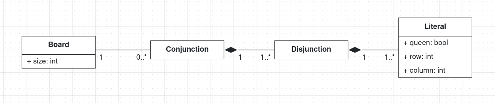
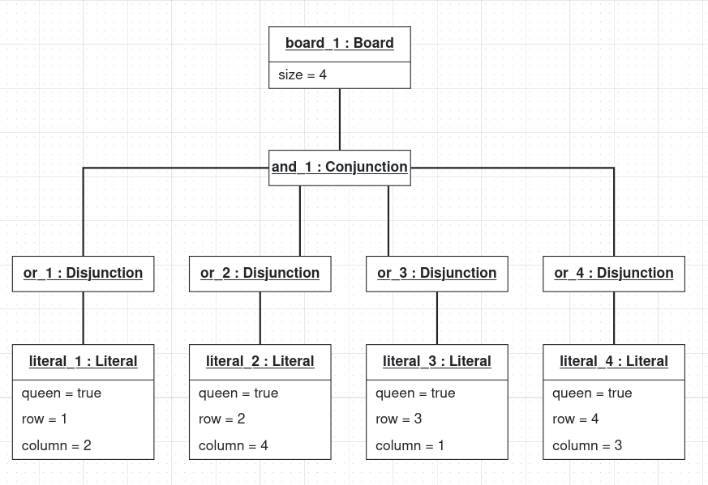

# Part I: N-Queens

Group TACS_G12

## Problem DSL

### N-Queens completion

The selected problem is N-Queens completion. Given an (N \times N) chessboard with some queens already positioned, the goal is to place the remaining queens so that no two queens attack each other.

Normal N-Queens is easy, because known rules give a solution for any N. However once some queens are fixed, those rules can break and finding a valid completion becomes hard. That makes it a good fit for Class B: it is a hard search problem that can be written as a Boolean formula (CNF) and attacked with Grover's search algorithm.

The constraints are:

- At least one queen per row.
- At most one queen per row.
- At most one queen per column.
- At most one queen per diagonal.

The problem model describes the board, the constraints and any pre-filled queen positions. It does not describe the completed solution and it contains no logic or quantum circuits.

### Test instance

This report uses one small example: a 4x4 board with queens at (1,2) and (3,1). Rows 2 and 4 are still empty, and the only valid completion puts queens at (2,4) and (4,3).

| . | Q | . | . |
|---|---|---|---|
| . | . | . | . |
| Q | . | . | . |
| . | . | . | . |

### Problem DSL metamodel

The Problem DSL metamodel is defined in BESSER. It has the concepts `Problem`, `Board`, `Queen`, `FixedPosition` and `Constraint`, and also the `ConstraintType` enumeration.

A `Problem` has a `Board` and a set of `Constraint` objects. The board can contain `Queen` and `FixedPosition` objects. The constraint types cover the row, column and diagonal rules.

| Concept | Attributes | Description |
|---|---|---|
| `Problem` | `name: str` | Identifies the N-Queens problem instance. |
| `Board` | `size: int` | Side length of the square chessboard. |
| `Queen` | `row: int`, `column: int` | A queen positioned on the board. |
| `FixedPosition` | `row: int`, `column: int` | A queen that is already placed and must be kept when completing the board. |
| `Constraint` | `type: ConstraintType` | One rule the solution must satisfy. |
| `ConstraintType` | Enumeration | `AT_LEAST_ONE_PER_ROW`, `AT_MOST_ONE_PER_ROW`, `AT_MOST_ONE_PER_COLUMN` and `AT_MOST_ONE_PER_DIAGONAL`. |

The main associations are `Problem–Board`, `Problem–Constraint`, `Board–Queen` and `Board–FixedPosition`. Each problem has one board and a set of constraints. A board can hold any number of queens and fixed positions, and both associations are compositions because those objects belong to their board. The exact multiplicities are in the BESSER metamodel.

#### Design choices

- Rules are real objects. A `Problem` owns `Constraint` objects instead of hiding the rules in code. Each rule type later produces one family of clauses, so any clause in the final formula traces back to the rule that caused it.
- Fixed positions get their own concept. Pre-filled queens are what turn plain N-Queens into a completion problem. Keeping them separate lets them translate into the simplest possible clauses, a single cell that must be true.
- The model describes the starting point, not the answer. The board does not have to be full, so the OCL rules below do not ask for a complete solution.

### Example problem model

The BESSER object diagram below shows a small N-Queens instance. The board size is 4, and the problem is linked to the four constraint types.

The diagram shows the problem instance and its constraints, not a finished solution. Each pre-filled queen is a `FixedPosition` object linked to the board, and these positions stay unchanged while the remaining queens are placed. The diagram therefore has one `FixedPosition` object for each pre-filled queen in the test instance.

### OCL constraints

OCL (Object Constraint Language) specifies extra invariants that instances of the Problem DSL metamodel must satisfy. They are defined in `constraints/NQueens.ocl`:

- ValidSize: the board size must be greater than zero.
- QueensWithinBoard: every queen must have row and column coordinates inside the board.
- FixedPositionsWithinBoard: every fixed position must lie inside the board.
- FixedPositionsCorrespondToQueens: every fixed position must match a queen at the same coordinates.
- NoConflictingQueens: no two distinct queens may share a row, column or diagonal.
- NoConflictingFixedPositions: no two fixed positions may share a row, column or diagonal.

These constarints make sure the model is a valid partial N-Queens configuration. The board does not have to be complete since the problem DSL only represents the initial state of the completion problem.

The last invariant matters because two fixed queens that already attack each other make the puzzle unsolvable and the formula would be unsatisfiable.

The OCL constraints cover semantic properties that the structure of the metamodel cannot express. Their syntax still has to be checked against the chosen OCL implementation before being executed.

## Solution DSL

The solution model is a Boolean formula in Conjunctive Normal Form (CNF), which works like a checklist. The formula is an AND of clauses, and each clause is an OR of simple yes or no statements. The formula is true only if every clause is satisfied.

The problem maps to CNF with one variable per board cell. For example, on an empty 4x4 board, exactly one queen in the first row is written as follows (first digit is the row, second digit is the column):

$$
(11 \lor 12 \lor 13 \lor 14) \land (\neg 11 \lor \neg 12) \land (\neg 11 \lor \neg 13) \land (\neg 11 \lor \neg 14) \land (\neg 12 \lor \neg 13) \land (\neg 12 \lor \neg 14) \land (\neg 13 \lor \neg 14)
$$

We use plain CNF because Grover's oracle is built clause by clause. Each clause is computed into a helper qubit (called an ancilla), a multi-controlled gate checks that all helpers are true, and then everything is undone.

### Metamodel

The metamodel is a basic CNF with literals specialized for N-Queens:

| Concept | Attributes | Description |
|---|---|---|
| `Board` | `size: int` | The board dimensions. |
| `Conjunction` | | A CNF instance: a conjunction of clauses, an "AND of ORs". |
| `Disjunction` | | One clause: a disjunction of literals, an "OR of conditions". |
| `Literal` | `queen: bool`, `row: int`, `column: int` | A statement about the cell at the given row and column, inside the disjunction it belongs to. With `queen = true` it says there is a queen at this cell. With `queen = false` it says there is none (a negation). |

### How the problem rules become clauses

| Problem concept | Clauses it produces |
|---|---|
| `FixedPosition` (r,c) | One single-literal clause (rc). |
| `AT_LEAST_ONE_PER_ROW` | One clause per row, e.g. (11 ∨ 12 ∨ 13 ∨ 14). |
| `AT_MOST_ONE_PER_ROW`, `_COLUMN`, `_DIAGONAL` | For every pair of cells on the same line, a clause (¬a ∨ ¬b), meaning "not both" (the standard pairwise encoding). |

### Example solution model

The CNF for an empty board is very long. For an empty 4x4 board it reads as follows.

At least one queen per row:

$$
\newline
(11 \lor 12 \lor 13 \lor 14) \land (21 \lor 22 \lor 23 \lor 24) \land (31 \lor 32 \lor 33 \lor 34) \land (41 \lor 42 \lor 43 \lor 44)
\newline
$$

At most one queen per row:

$$
\newline
\land [(\neg 11 \lor \neg 12) \land (\neg 11 \lor \neg 13) \land (\neg 11 \lor \neg 14) \land (\neg 12 \lor \neg 13) \land (\neg 12 \lor \neg 14) \land (\neg 13 \lor \neg 14)]
\newline
\land [(\neg 21 \lor \neg 22) \land (\neg 21 \lor \neg 23) \land (\neg 21 \lor \neg 24) \land (\neg 22 \lor \neg 23) \land (\neg 22 \lor \neg 24) \land (\neg 23 \lor \neg 24)]
\newline
\land [(\neg 31 \lor \neg 32) \land (\neg 31 \lor \neg 33) \land (\neg 31 \lor \neg 34) \land (\neg 32 \lor \neg 33) \land (\neg 32 \lor \neg 34) \land (\neg 33 \lor \neg 34)]
\newline
\land [(\neg 41 \lor \neg 42) \land (\neg 41 \lor \neg 43) \land (\neg 41 \lor \neg 44) \land (\neg 42 \lor \neg 43) \land (\neg 42 \lor \neg 44) \land (\neg 43 \lor \neg 44)]
\newline
$$

At most one queen per column:

$$
\newline
\land [(\neg 11 \lor \neg 21) \land (\neg 11 \lor \neg 31) \land (\neg 11 \lor \neg 41) \land (\neg 21 \lor \neg 31) \land (\neg 21 \lor \neg 41) \land (\neg 31 \lor \neg 41)]
\newline
\land [(\neg 12 \lor \neg 22) \land (\neg 12 \lor \neg 32) \land (\neg 12 \lor \neg 42) \land (\neg 22 \lor \neg 32) \land (\neg 22 \lor \neg 42) \land (\neg 32 \lor \neg 42)]
\newline
\land [(\neg 13 \lor \neg 23) \land (\neg 13 \lor \neg 33) \land (\neg 13 \lor \neg 43) \land (\neg 23 \lor \neg 33) \land (\neg 23 \lor \neg 43) \land (\neg 33 \lor \neg 43)]
\newline
\land [(\neg 14 \lor \neg 24) \land (\neg 14 \lor \neg 34) \land (\neg 14 \lor \neg 44) \land (\neg 24 \lor \neg 34) \land (\neg 24 \lor \neg 44) \land (\neg 34 \lor \neg 44)]
\newline
$$

At most one queen per diagonal:

$$
\newline
\land [(\neg 13 \lor \neg 24)]
\newline
\land [(\neg 12 \lor \neg 23) \land (\neg 12 \lor \neg 34) \land (\neg 23 \lor \neg 34)]
\newline
\land [(\neg 11 \lor \neg 22) \land (\neg 11 \lor \neg 33) \land (\neg 11 \lor \neg 44) \land (\neg 22 \lor \neg 33) \land (\neg 22 \lor \neg 44) \land (\neg 33 \lor \neg 44)]
\newline
\land [(\neg 21 \lor \neg 32) \land (\neg 21 \lor \neg 43) \land (\neg 32 \lor \neg 43)]
\newline
\land [(\neg 31 \lor \neg 42)]
$$

---

Given the initial queen positions, the CNF shrinks a lot. Each fixed queen rules out every cell it attacks, and those cells drop out of the formula. On a 4x4 board with queens at (1,2) and (3,1), only 3 cells remain for the other 2 queens:

| . | Q | . | . |
|---|---|---|---|
| . | . | . | ? |
| Q | . | . | . |
| . | . | ? | ? |

This translates to the following CNF:

$$
(24) \land (43 \lor 44) \land (\neg 43 \lor \neg 44) \land (\neg 24 \lor \neg 44)
$$

Read as a checklist:

- there must be a queen at 24;
- there is a queen at 43 or 44, but not both;
- 24 and 44 cannot both hold.

The only assignment that passes all four clauses has 24 and 43 true and 44 false, so the instance has exactly one solution.

### OCL constraints

This model keeps only a subset of the problem DSL constraints:

- ValidSize: the board size must be greater than zero.
- PositionsWithinBoard: all positions must lie inside the board.

These invariants keep the model semantically correct, but they do not guarantee that the CNF is satisfiable. "No solution" is a valid outcome for a completion problem, so this is deliberate.

<!-- ## Codification

### Limit of 12 qubits

The quantum circuit implementation is subject to a limit of **12 qubits**. The encoding therefore affects the size of the instances that can be considered.

For a \(4 \times 4\) board:

- 4 rows correspond to 4 variables.
- Each variable requires \(\log_2(4)=2\) qubits to encode the column of the queen in that row.
- Total: \(4 \times 2 = 8\) qubits.

Therefore, a \(4 \times 4\) N-Queens instance fits within the 12-qubit limit. Under this encoding, a row variable represents the column selected for the queen in that row. Pre-filled positions restrict the corresponding variable to the specified column. -->

## References

- Grover, L. K. (1996). A fast quantum mechanical algorithm for database search.
- Gent, I. P., Jefferson, C., Nightingale, P. (2017). Complexity of n-Queens completion.
- Nielsen, M. A., Chuang, I. L. Quantum Computation and Quantum Information.