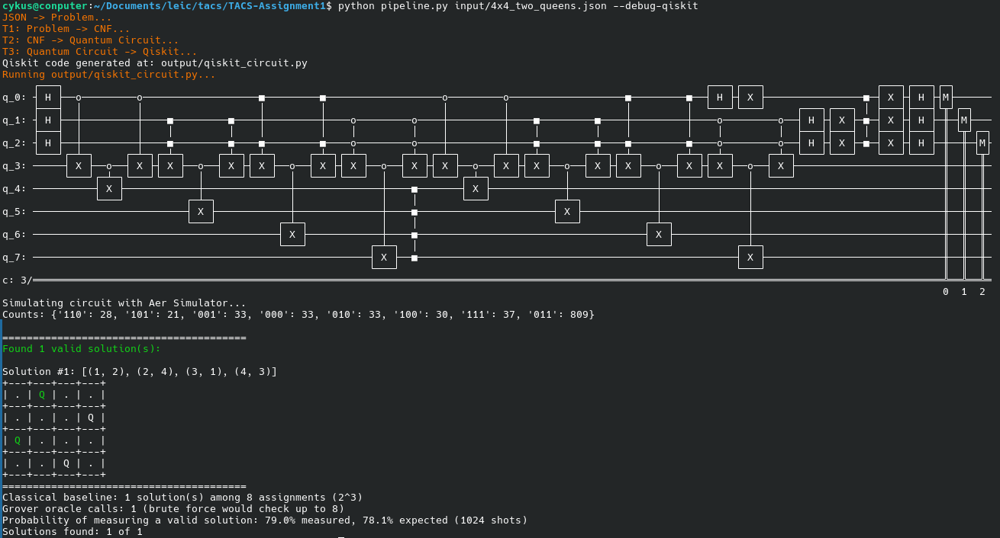
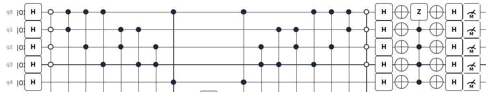
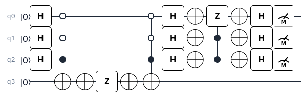
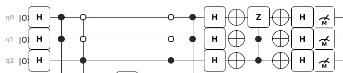

# Part II: Quantum Transformation, Code Generation, and Validation

Group TACS_G12

## T2: CNF to Quantum Circuit

`transformations/t2.py` converts the CNF model into a platform-independent BESSER quantum circuit. A CNF can be mapped to a Grover Circuit as follows:
- Each candidate board cell in the CNF gets a **data qubit**. A value of 1 means a queen is placed; 0 means the cell is empty.
- Hadamard gates put the data qubits into a superposition of all $2^n$ assignments.
- A clause is mapped as a multi-controlled X gate (MCX), where the target qubit is an ancilla and its control qubits are the variables in the clause (Control=negation, Anti-Control=not negated).
- By default, clauses are split into groups of about $\sqrt{C}$, where $C$ is the number of clauses. The group size can also be set in the solver configuration. Each group of clauses is handled by a single ancilla. A smaller amount of ancillas leads to longer circuits, and vice-versa.
- The oracle checks the CNF, flips the phase of satisfying assignments, and clears the ancillas. The diffuser then amplifies those assignments. These steps are repeated for the selected number of Grover rounds, and the data qubits are measured.

If the number of rounds is not set in the configuration, T2 calculates it from $n$, the number of data qubits, and $M$, the number of solutions found by the classical solver:

$$
k = \left\lfloor \frac{\pi}{4} \sqrt{\frac{2^n}{M}} \right\rfloor
$$

If there are no solutions ($M = 0$), the circuit uses zero Grover rounds.

## T3: Code Generation and Execution

`QiskitGenerator` translates the quantum model into a Python script. The pipeline runs that script with Qiskit's `AerSimulator`, using the configured number of shots.

Each measured bitstring is mapped back to board cells using `qubit_mapping`. The pipeline accounts for Qiskit's bit order, adds the fixed queens, and keeps bitstrings whose counts are more than 10% of the highest count. Valid boards are then printed as solutions.

## Validation Results

The classical backtracking solver, `solve_nqueens` in `baseline.py`, provides the reference solution count and configurations. The table summarizes the recorded Aer Simulator runs with 1024 shots.

| Instance | Data qubits | Total qubits | Solutions | Grover rounds | Solutions found |
|---|---:|---:|---:|---:|---:|
| `10x10_seven_queens` | 6 | 13 | 2 | 4 | 2 / 2 |
| `4x4_impossible` | 6 | 14 | 0 | 0 | 0 / 0 |
| `4x4_one_queen` | 6 | 14 | 1 | 6 | 1 / 1 |
| `4x4_two_queens` | 3 | 7 | 1 | 2 | 1 / 1 |
| `5x5_impossible` | 4 | 10 | 0 | 0 | 0 / 0 |
| `5x5_two_queens` | 4 | 9 | 1 | 3 | 1 / 1 |
| `6x6_three_queens` | 5 | 12 | 1 | 4 | 1 / 1 |

All solutions were found for the satisfiable instances in these runs. The two impossible instances correctly produced no solutions.

The execution looks as follows (set `config/config.json` to only build one oracle and therefore make circuit shorter, which is why estimated success probability is low):

## Limitations

The number of possible assignments grows exponentially with the number of data qubits, which limits classical simulation of large boards. The CNF oracle also needs ancillas to evaluate clauses and clause groups. Fixed queens reduce the search by removing cells that cannot contain another queen.

One potential improvement would be to reduce the amount of data qubits by mapping variables on the same line/column/diagonal into a binary number representation of one or more qubits, where each value represents one of the variables. All variables in the same binary number mapping MUST be on the same line/column/diagonal to ensure there is exactly one outcome, otherwise the qubits lose meaning.

The simplest form would be by having two mutually-exclusive variables represnted by a single qubit, where a 0 translates to one variable and a 1 to the other.

Multi-qubit mapping is possible by applying De Morgan's Laws: as an example, if we wish to select exactly one variable out of 4, and make it so variable 1 is mutually exclusive with a 5th variable, our current approach would create a circuit like this:

This is because we not only need one qubit per variable, but also to mutually exclude every pair of variables from 1 to 4. If we instead map variables 1-4 into 2 qubits ($q_0$ and $q_1$), the output $q_0 q_1$ now represents the selected variable for the solution (00=1, 01=2, 10=3, 11=4), removing the $O(N^2)$ pairwise clauses in the circuit (where $N$ is the number of variables being grouped).

To mutually exclude variable 1 ($q_0 q_1$=00) with 5 ($q_2$), we can use De Morgan's Laws and keep the CNF structure:

$$
(\neg(\neg q_0 \land \neg q_1) \lor \neg q_2) = (\neg \neg (q_0 \lor q_1) \lor \neg q_2) = (q_0 \lor q_1 \lor \neg q_2)
$$

Which can then be mapped to the following circuit:

proving that this optimization can drastically reduce the amount of computation and qubits needed. If a mapping leaves meaningless values (e.g. if we map 3 variables into 2 qubits, $q_i q_j$=11 is meaningless), we can either ignore/reject it in the results or ensure the circuit itself rejects it ($\neg q_0 \lor \neg q_1$):

Another optimization problem, however, is in the selection of variables to map to the same group of data qubits, since there are multiple possible combinations and a naive approach would not be optimal (and an optimal one is likely NP-hard).
